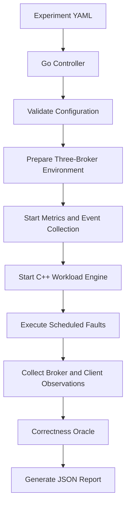

# Hydra Stream — Hybrid Simulation Engine

> Documentation package for designing and implementing a reproducible workload + chaos simulation system for Hydra Stream.

## Purpose

The Hybrid Simulation Engine runs controlled experiments against a Hydra Stream cluster. It generates realistic producer/consumer traffic, injects controlled faults, collects observations, and evaluates correctness assertions.

It is a test and experimentation subsystem. It must not become a dependency of the broker's data plane.

## Documentation map

| Document | Purpose |
|---|---|
| [00 — Vision and Problem](docs/00-vision-and-problem.md) | Why the simulator exists and what problems it solves |
| [01 — Proposed Solution](docs/01-proposed-solution.md) | Scope, capabilities, boundaries and MVP |
| [02 — System Architecture](docs/02-system-architecture.md) | Components, responsibilities and data flows |
| [03 — Experiment Lifecycle](docs/03-experiment-lifecycle.md) | State machine, scheduling and cancellation |
| [04 — Experiment Configuration](docs/04-experiment-configuration.md) | YAML schema proposal and validation rules |
| [05 — Workload Engine](docs/05-workload-engine.md) | C++ producers, consumers, traffic patterns and message identity |
| [06 — Fault Injection](docs/06-fault-injection.md) | Broker, network and resource fault mechanisms |
| [07 — Observability and Metrics](docs/07-observability-and-metrics.md) | Events, metrics, histograms and reporting |
| [08 — Correctness Oracle](docs/08-correctness-oracle.md) | Message ledger, assertions and delivery semantics |
| [09 — Cluster Deployment](docs/09-cluster-deployment.md) | Three-broker Docker Compose test environment |
| [10 — Implementation Roadmap](docs/10-implementation-roadmap.md) | Incremental delivery plan |
| [11 — First Sprint](docs/11-first-sprint.md) | Concrete MVP tasks and acceptance criteria |
| [12 — Testing and Safety](docs/12-testing-and-safety.md) | Test strategy, safety controls and failure containment |
| [13 — Decisions and Open Questions](docs/13-decisions-and-open-questions.md) | Explicit decisions, assumptions and unresolved contracts |
| [Visual Diagrams](docs/system-diagrams.md) | Comprehensive Mermaid diagrams covering all phases, networking, topologies, and lifecycles |

## High-level experiment flow

## Important scope boundary

The initial target is a **three-broker Docker environment**, but three running processes do not automatically constitute a correct distributed cluster.

The simulator can validate process availability, client connectivity, workload generation, metrics collection and controlled broker stop/start before Hydra Stream implements replication, leader election and safe failover. Assertions must be enabled only when the corresponding broker capability exists.

## Technology direction

- Broker under test: C++ Hydra Stream.
- Experiment controller: Go.
- Workload generator: C++.
- Initial orchestration: Docker Compose and Docker CLI/API.
- Experiment configuration: YAML.
- Internal observations: versioned JSONL event records.
- Results: JSON and human-readable Markdown.
- Network faults: Linux `tc netem` in a later milestone.

## Status and language

This is a **design proposal**, not a claim that these components already exist. Words such as *MUST*, *SHOULD* and *MAY* describe proposed requirements for implementation.

The design is based on the Hydra Stream project blueprint and the decisions made while planning the hybrid simulation engine. Broker-specific APIs and protocol details remain subject to inspection of the existing implementation.
