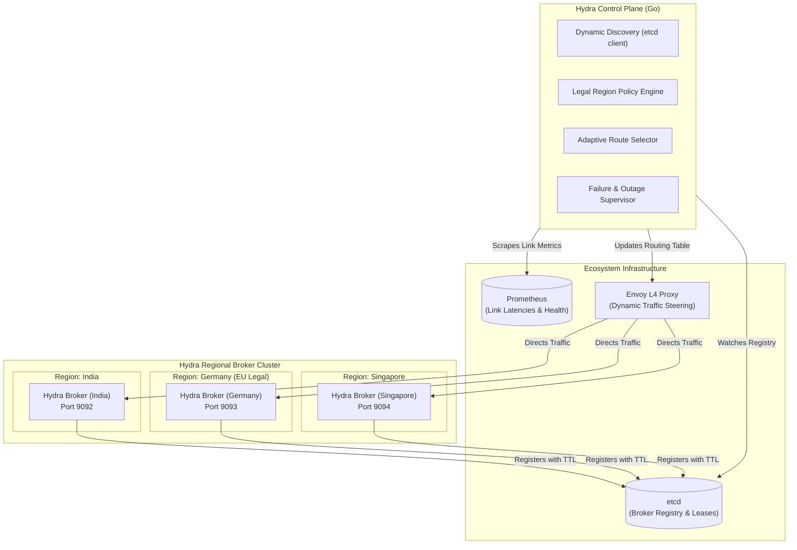

# Hydra Stream — Geo-Distributed Resilient Streaming Platform

> **Mission**: Build a Kafka-style broker that keeps data inside its legal region, routes around slow links, and survives a regional outage without freezing.  
> **Target Outcome**: *SDG 9.1 — Resilient Infrastructure*

---

## 1. Executive Summary

Traditional message brokers like Apache Kafka are region-blind and network-fragile:
1. **No Legal Data Residency**: Kafka does not understand geographic or regulatory jurisdictions (e.g., GDPR). Data replicated across brokers can illegally cross borders.
2. **Head-of-Line Blocking on Slow Links**: If an inter-datacenter link experiences latency spikes or packet loss, static partition hashing (`Murmur2(key) % N`) causes producer pipelines to stall and freeze.
3. **Cluster Freezes on Regional Outage**: A cluster-wide quorum loss (KRaft or ZooKeeper) during a regional disaster can freeze all reads and writes globally.

**Hydra Stream** solves these challenges by combining:
- **A Lean, Kafka-Style C++ Broker**: High-performance in-memory bounded queues with condition-variable backpressure, thread pools, and sequential offset tracking.
- **Hydra Control Plane (Go)**: Coordinates dynamic discovery via **`etcd`**, tracks cross-region latency metrics via **`Prometheus`**, enforces legal data-residency policies, and dynamically routes around slow or degraded inter-region links.
- **Integrated Chaos & Simulation Engine**: Validates data residency compliance, slow-link failover, and crash recovery with zero third-party dependencies.

---

## 2. Architecture Overview

---

## 3. The 3 Core Pillars

### Pillar 1: Legal Data Residency (Geo-Fencing)
* Topics declare their legal residency (e.g. `legal_region: Germany / EU`).
* The Hydra Control Plane guarantees that **zero bytes** of EU-restricted data are ever routed, buffered, or replicated on brokers in India or Singapore.

### Pillar 2: Dynamic Routing Around Slow Links
* Real-time network health is tracked between regions (RTT and packet drop rates via Prometheus/pings).
* If the link between India and Germany degrades (e.g. latency spikes from 80ms to 450ms), the Control Plane dynamically re-routes traffic through healthy regional paths or holds at local ingress rather than freezing the pipeline.

### Pillar 3: Regional Outage Survival Without Freezing
* If an entire region (e.g., Germany) suffers a complete power or network blackout, the remaining regions (India, Singapore) switch to Local Quorum Mode and **continue serving reads and writes without deadlocking or cluster freeze**.

---

## 4. Documentation Index

| Document | Purpose |
|---|---|
| [00 — Vision and Problem](docs/00-vision-and-problem.md) | Problem statement, SDG 9.1 alignment, and regulatory boundaries |
| [01 — Proposed Solution](docs/01-proposed-solution.md) | Component stack, Go Control Plane, etcd, Prometheus, and broker daemons |
| [02 — System Architecture](docs/02-system-architecture.md) | Detailed process model, regional boundaries, and network flows |
| [03 — Experiment Lifecycle](docs/03-experiment-lifecycle.md) | State machine for testing regional chaos and link degradation |
| [04 — Experiment Configuration](docs/04-experiment-configuration.md) | YAML schema for regions, traffic profiles, and slow-link fault injection |
| [05 — Workload Engine](docs/05-workload-engine.md) | C++ multi-region producer/consumer traffic generator |
| [06 — Fault Injection](docs/06-fault-injection.md) | Slow link injection (tc netem), regional blackouts, and container stops |
| [07 — Observability and Metrics](docs/07-observability-and-metrics.md) | Prometheus metrics, latency percentiles (P50/P95/P99), and JSONL events |
| [08 — Correctness Oracle](docs/08-correctness-oracle.md) | In-memory verification for zero message loss and residency policy audits |
| [09 — Cluster Deployment](docs/09-cluster-deployment.md) | Docker Compose multi-region cluster (India, Germany, Singapore, etcd) |
| [10 — Implementation Roadmap](docs/10-implementation-roadmap.md) | Phased milestones from local broker daemon to full cross-region routing |
| [11 — First Sprint](docs/11-first-sprint.md) | Concrete MVP sprint tasks and acceptance criteria |
| [12 — Testing and Safety](docs/12-testing-and-safety.md) | Unit, integration, chaos, and residency safety testing strategy |
| [13 — Decisions and Open Questions](docs/13-decisions-and-open-questions.md) | Architectural Decision Records (ADRs) and trade-offs |
| [Visual Diagrams](docs/system-diagrams.md) | Comprehensive Mermaid diagrams for all lifecycles, network, and regions |
