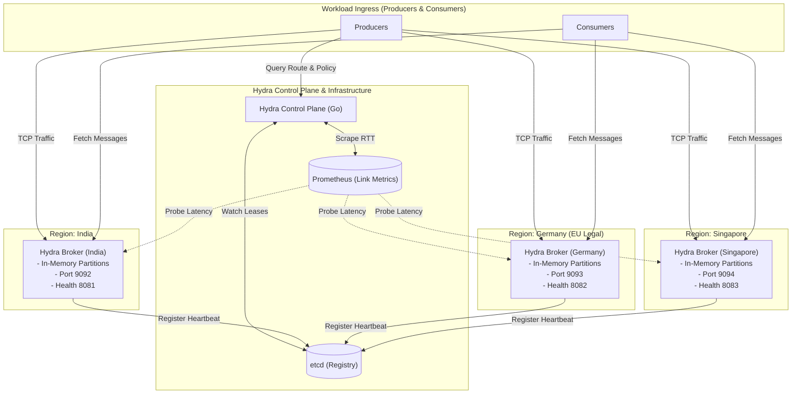

# 02 — System Architecture

## 1. Multi-Region System Topology

The Hydra Stream architecture spans three logical geographic regions, coordinated by the **Hydra Control Plane** and backed by **`etcd`** and **Prometheus**.



---

## 2. Process Boundaries & Subsystems

### 2.1 The Hydra Control Plane (Go)
* **Language**: Go
* **Responsibilities**:
  1. **Node Watcher**: Listens to `etcd` key changes under `/registry/brokers/`.
  2. **Policy Validator**: Compares topic metadata against broker region metadata. Enforces that `legal_region: Germany` can only be routed to German broker endpoints.
  3. **Route Optimizer**: Evaluates Prometheus latency data. When an inter-region link degrades past a configurable threshold ($\text{RTT} > 200\text{ms}$ or error rate $> 2\%$), marks the route as `DEGRADED` and dynamically recalculates partition ingress weights.
  4. **Health Supervisor**: Monitors broker health endpoints and manages failover during regional disconnects.

### 2.2 The Hydra Broker Daemon (C++)
* **Language**: C++17
* **Responsibilities**:
  1. **Ingress TCP/HTTP Listener**: Listens on a dedicated port for `PRODUCE` and `FETCH` commands.
  2. **Bounded Queue Engine**: Holds messages in thread-safe, bounded in-memory queues (`ConcurrentQueue<Message>`). Protects RAM from OOM crashes via dual condition-variable backpressure.
  3. **Sequential Offset Manager**: Assigns monotonic sequential offsets (`0, 1, 2...`) to arriving messages.
  4. **Thread Pool Executor**: Offloads consumer task dispatching to worker threads via `std::packaged_task` and `std::future`.
  5. **Actor-Pattern Logger**: Lock-free background thread logging.
  6. **Self-Registration Agent**: Publishes heartbeat leases to `etcd` on startup.

---

## 3. Communication Protocols & Interfaces

### 3.1 Broker Registration Interface (etcd JSON Schema)
```json
{
  "broker_id": "broker-india-1",
  "region": "India",
  "host": "hydra-broker-india",
  "port": 9092,
  "health_port": 8081,
  "started_at": 1730376000,
  "status": "UP"
}
```

### 3.2 Client–Broker Wire Protocol (TCP Frame)
Every network frame exchanged between clients and the broker follows a lean binary header:

```
+------------+------------+---------------+------------------+--------------------+---------------------+
| Magic Byte | Version    | OpCode        | Correlation ID   | Payload Length     | Payload Data        |
| 0x48 ('H') | 0x01 (1 B) | 2 Bytes (u16) | 8 Bytes (u64)    | 4 Bytes (u32)      | N Bytes             |
+------------+------------+---------------+------------------+--------------------+---------------------+
```

* **OpCodes**:
  * `0x0001` : `PRODUCE_REQ`
  * `0x0002` : `PRODUCE_ACK` (returns assigned monotonic offset)
  * `0x0003` : `FETCH_REQ` (requests messages starting at offset)
  * `0x0004` : `FETCH_RES`
  * `0x0005` : `HEALTH_PING`
