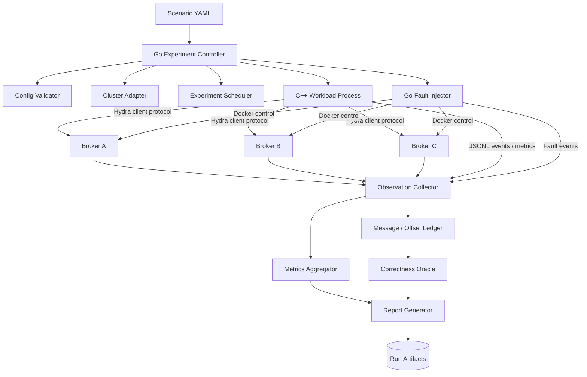

# 02 — System Architecture

## 1. Logical architecture



## 2. Architectural boundaries

### Control plane of the simulator

The Go controller coordinates experiments, process lifecycle, schedules and result collection. It is not part of Hydra Stream's message data path.

### Workload data path

The C++ workload executable uses Hydra Stream's actual client protocol or supported client library. It must not bypass the broker by writing directly to broker storage.

### Fault control path

The fault injector controls only resources explicitly tagged as belonging to the simulator. It records an event before and after each fault action.

### Observation path

Events and measurements are sent to a collector. Observability failure must be reported; the simulator must not silently treat missing observations as success.

## 3. Process model

Initial deployment:

- One controller process.
- One workload process per experiment (internally multi-threaded).
- One fault-injector capability inside the controller process or a separately supervised process.
- Three independent broker processes/containers.
- One observation collector, initially embedded in the controller or run as a local service.

Avoid creating a microservice for every package. Keep deployment simple while preserving code-level interfaces.

## 4. Proposed interfaces

### Cluster adapter

```go
type Cluster interface {
    Validate(ctx context.Context) error
    Start(ctx context.Context) error
    WaitHealthy(ctx context.Context) error
    StopBroker(ctx context.Context, brokerID string) error
    StartBroker(ctx context.Context, brokerID string) error
    BrokerStatus(ctx context.Context, brokerID string) (BrokerStatus, error)
    Cleanup(ctx context.Context) error
}
```

The exact interface may change after inspecting the current Docker setup.

### Workload process

The controller launches a versioned executable with a generated runtime configuration and run identifier. The process emits structured events and a final summary.

### Event envelope

Every event should include:

- `schema_version`
- `run_id`
- `event_id`
- `source`
- `event_type`
- `wall_time`
- `elapsed_ns`
- `attributes`

Use wall-clock time for human correlation and monotonic elapsed time for experiment ordering and durations.

## 5. Failure containment

- Every run has a unique ID and resource labels.
- The controller owns child-process handles.
- On cancellation, stop scheduling new faults and request workload shutdown.
- Attempt fault recovery for any applied fault.
- Persist partial results even if cleanup fails.
- Never clean up resources that cannot be positively identified as simulator-owned.

## 6. Future evolution

The initial collector can use JSONL files. If event volume or remote execution later requires it, replace the transport behind an interface without changing experiment semantics.
