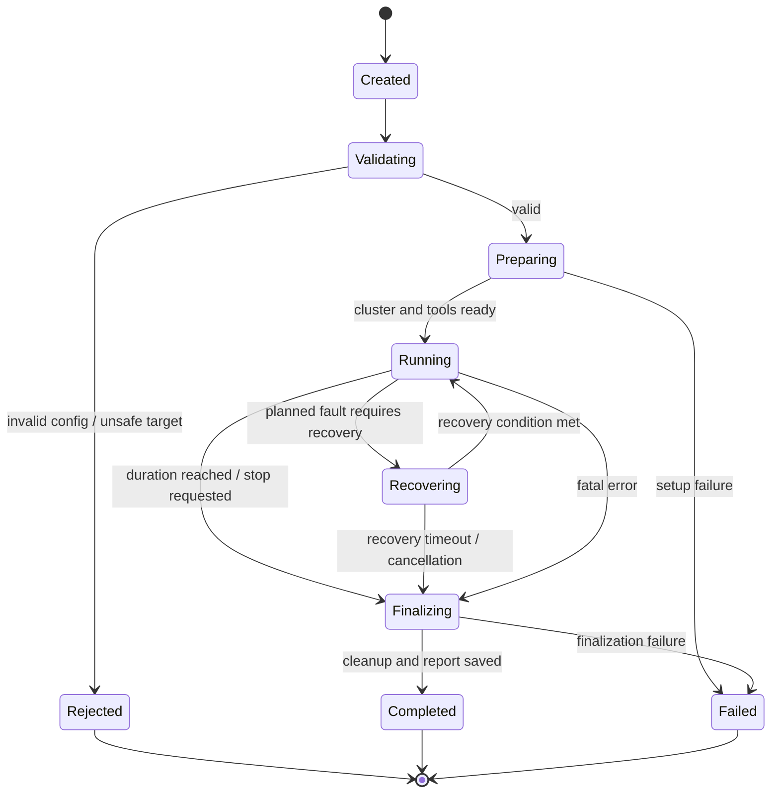

# 03 — Experiment Lifecycle

## 1. State machine



`Recovering` is an experiment phase, not necessarily a broker state. It is used when the scenario asks the controller to wait for a defined recovery condition after a fault.

## 2. State definitions

| State | Meaning |
|---|---|
| `CREATED` | Run ID allocated; no resources changed |
| `VALIDATING` | Validate schema, capabilities, targets and safety constraints |
| `PREPARING` | Start/inspect cluster, workload dependencies and collectors |
| `RUNNING` | Workload is active and scheduled events execute |
| `RECOVERING` | Wait for scenario-defined recovery condition |
| `FINALIZING` | Stop workers, recover faults, flush observations and report |
| `COMPLETED` | Planned lifecycle finished; assertions may still fail |
| `FAILED` | Infrastructure or controller failure prevented valid completion |
| `REJECTED` | Configuration or safety validation rejected the run |

## 3. Lifecycle rules

1. A run cannot enter `RUNNING` until required brokers and the collector are ready.
2. Fault actions must be validated before the run begins.
3. Faults execute at experiment-relative monotonic deadlines.
4. The scheduler records planned time, actual start time and completion time.
5. A fault action must have a recovery strategy or explicitly declare itself non-reversible.
6. Cancellation stops future scheduled actions.
7. Finalization attempts to recover applied faults before cleanup.
8. Partial results must be preserved after failure.
9. `COMPLETED` means execution completed, not that all assertions passed.

## 4. Timing model

Use a monotonic clock for:

- Experiment elapsed time.
- Scheduled fault deadlines.
- Request latency.
- Recovery duration.

Record UTC wall-clock timestamps for logs and cross-process correlation. Do not schedule events by repeatedly comparing wall-clock timestamps, because wall-clock adjustments can move backward or forward.

## 5. Scheduling example

For a scenario with duration 300 seconds:

```text
T+000s  prepare complete; start workload
T+060s  stop broker-b
T+100s  start broker-b
T+300s  stop workload and finalize
```

The scheduler should use one experiment clock and a priority queue ordered by event deadline. Events with the same deadline need a deterministic tie-breaking rule, such as configured order then event ID.

## 6. Cancellation and timeout behavior

- Every operation accepts a context/deadline.
- Controller shutdown cancels the experiment context.
- Child processes receive graceful termination first, then forced termination after a bounded grace period.
- Applied faults are tracked in an active-fault registry.
- Recovery attempts have their own timeout.
- A cleanup failure is recorded in the final report and must not be hidden.
