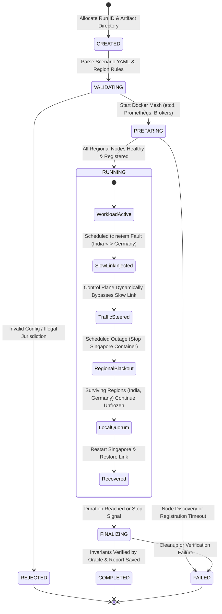

# 03 — Multi-Region Experiment Lifecycle

## 1. Lifecycle State Machine

The Hydra Experiment Controller manages multi-region experiments through a deterministic monotonic state machine:

---

## 2. Phase Definitions

| State | Detailed Meaning |
|---|---|
| `CREATED` | Scenario allocated; unique run directory created under `results/<run-id>/`. |
| `VALIDATING` | Schema validation. Enforces that all legal region policies (e.g. `Germany / GDPR`) map to valid cluster nodes. |
| `PREPARING` | Starts Docker network `hydra-mesh`, brings up `etcd`, `prometheus`, and regional brokers. Waits for all nodes to obtain dynamic `etcd` TTL leases. |
| `RUNNING` | Regional workload is actively pumped. Scheduled chaos actions (slow link `tc netem`, container stops) execute against monotonic deadlines. |
| `FINALIZING` | Gracefully terminates clients, removes injected network delays, flushes all JSONL observation records, and invokes the Correctness Oracle. |
| `COMPLETED` | The experiment finished all planned lifecycle stages, and reports (`report.json`, `report.md`) are saved. |
| `FAILED` | Infrastructure failure or unrecoverable Docker error aborted the run. |
| `REJECTED` | Unsafe or invalid configuration rejected before modifying any resources. |

---

## 3. Monotonic Timing Model

* All scheduled faults (e.g., inject slow link at `T=40s`, kill Singapore at `T=90s`) trigger based on a monotonic experiment clock, eliminating operating-system wall-clock skew.
* Cross-region network latencies and client produce/fetch latencies are recorded as high-resolution nanosecond timestamps (`latency_ns`).
