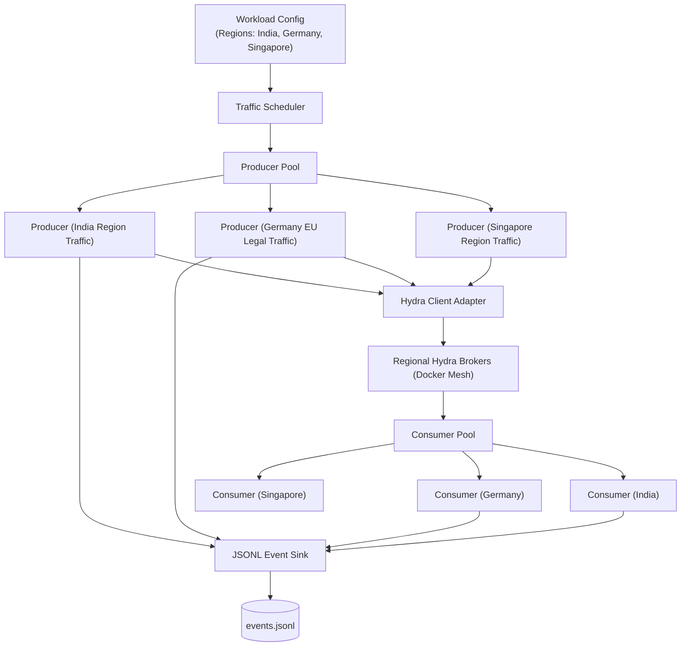

# 05 — Multi-Region Workload Engine

## 1. Responsibility

The C++ Workload Engine generates realistic cross-region producer and consumer traffic.  
It communicates exclusively over Hydra's network protocol (TCP framing). It does not bypass the network or manipulate broker memory directly.

---

## 2. Multi-Region Concurrency Architecture



---

## 3. Message Identity & Geo-Tagging

Every simulated message carries a strictly monotonic and traceable identity:

```cpp
struct MessageId {
    uint64_t run_id;            // Simulation Run ID
    uint32_t producer_id;       // Producer thread ID
    uint64_t sequence_number;   // Monotonic per-producer sequence (1, 2, 3...)
};

struct SimulatedMessage {
    MessageId id;
    std::string legal_region;   // e.g. "Germany", "India", or "ANY"
    uint64_t created_at_ns;     // Monotonic timestamp
    uint32_t payload_size;
    std::string payload;
};
```

---

## 4. Producer & Consumer Behavior Under Regional Chaos

### Producer Behavior:
1. Queries the **Hydra Control Plane** for the topic's authorized broker endpoints.
2. If the topic is `legal_region: Germany`, the producer connects **only** to the German broker node.
3. If an inter-region link degrades (e.g., India &harr; Germany latency spikes by 350ms), the producer adapter receives route steering signals from the Control Plane to avoid head-of-line blocking.
4. Records `produce.attempted`, `produce.acknowledged`, or `produce.unknown_outcome` (on network timeout).

### Consumer Behavior:
1. Connects to the regional broker and requests messages by sequential offset: `FETCH(topic, offset)`.
2. Emits `consumer.delivered` and `consumer.processed` events with precise delivery latency.
