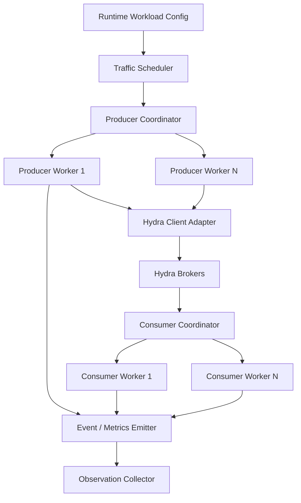

# 05 — Workload Engine

## 1. Responsibility

The C++ workload engine creates producer and consumer traffic through Hydra Stream's supported client interface. It must not write directly into broker storage or bypass the network protocol.

## 2. Internal architecture



## 3. Suggested source layout

```text
simulation/workload/
├── include/workload/
│   ├── config.hpp
│   ├── message.hpp
│   ├── producer.hpp
│   ├── consumer.hpp
│   ├── traffic_scheduler.hpp
│   ├── rate_limiter.hpp
│   ├── client_adapter.hpp
│   ├── event_sink.hpp
│   └── statistics.hpp
├── src/
│   ├── main.cpp
│   ├── producer.cpp
│   ├── consumer.cpp
│   ├── traffic_scheduler.cpp
│   └── statistics.cpp
├── tests/
└── CMakeLists.txt
```

## 4. Message identity

Every simulated message needs a stable identity that survives retries and consumer delivery.

Proposed logical identity:

```cpp
struct MessageId {
    uint64_t run_id;
    uint32_t producer_id;
    uint64_t sequence_number;
};
```

A message envelope used by the simulator may contain:

```cpp
struct SimulatedMessage {
    MessageId id;
    uint64_t created_at_monotonic_ns;
    uint32_t payload_size;
    std::vector<std::byte> payload;
};
```

This is simulator metadata. The actual wire encoding must follow Hydra Stream's real protocol and message model.

Use a per-producer monotonically increasing sequence number. Do not use timestamps as unique identifiers.

## 5. Producer behavior

Each producer worker should:

1. Obtain the next scheduled send opportunity.
2. Generate a unique message ID.
3. Record send-attempt time.
4. Submit through the Hydra client adapter.
5. Record success, broker acknowledgement, timeout or error.
6. Apply the configured retry policy, if any.
7. Emit structured observations.

A timeout is ambiguous: the broker may have appended the message even if the acknowledgement did not reach the producer. Record `UNKNOWN_OUTCOME` separately from confirmed failure.

## 6. Consumer behavior

Each consumer worker should:

1. Fetch messages using the supported consumer API.
2. Record delivery observation.
3. Validate the simulator message identity.
4. Apply configured processing delay.
5. Record processing success or failure.
6. Commit offsets only according to the scenario's configured behavior.

Do not confuse delivery with successful processing or committed progress.

## 7. Traffic patterns

Initial supported patterns:

| Pattern | Description |
|---|---|
| `constant` | Target a configured steady send rate |
| `burst` | Increase rate for a configured interval |
| `ramp` | Increase rate gradually |
| `random` | Seeded rate changes within configured bounds |

Start with `constant`. Add burst and ramp after baseline rate control is measured.

## 8. Open-loop and closed-loop modes

- **Open-loop:** schedule sends independently of response completion. Useful for overload and queueing studies. Record missed send deadlines so the generator does not hide overload.
- **Closed-loop:** send the next request after completion or when a concurrency slot becomes free. Useful for fixed-concurrency tests.

The report must identify the mode. Do not compare results from different modes as if they were equivalent.

## 9. Rate control and generator health

- Use monotonic time.
- Avoid one thread per message.
- Bound in-flight requests.
- Bound local event queues.
- Track scheduled versus actual send time.
- Track generator CPU and saturation.
- Report when the generator cannot sustain the configured rate.
- Do not report requested rate as achieved throughput.

## 10. Client adapter boundary

Hide the current Hydra client API behind an adapter. This allows the simulator to evolve if the broker protocol or client library changes.

Before implementation, inspect the existing broker/client code and document:
- Connection setup.
- Produce request and response.
- Fetch request and response.
- Partition selection.
- Acknowledgement semantics.
- Timeout and retry behavior.
- Offset commit behavior.
