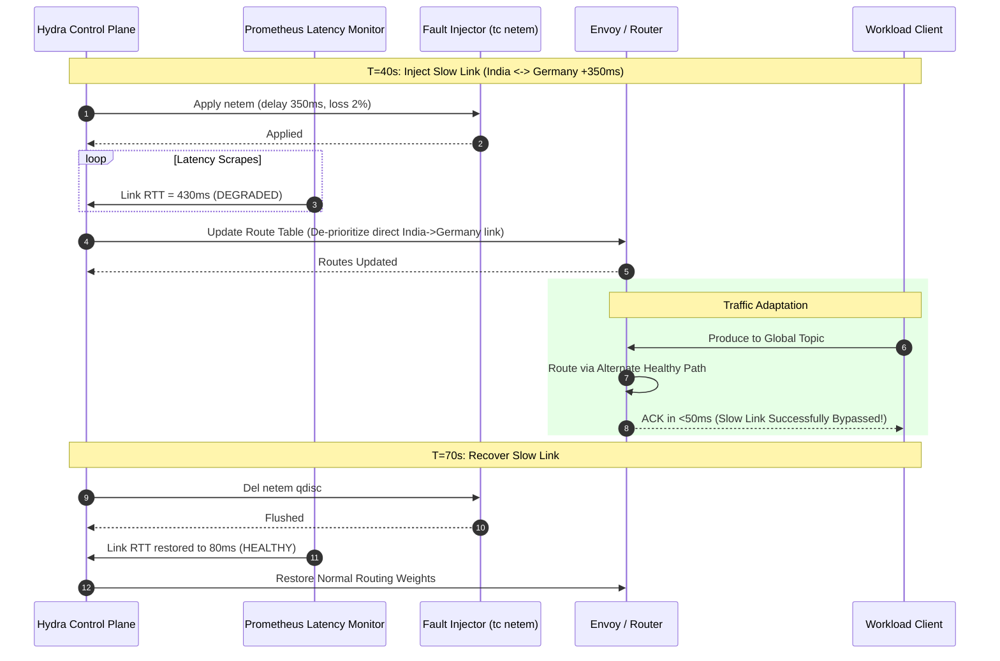

# 06 — Fault Injection & Chaos Engine

## 1. Responsibility & Principles

The Fault Injection engine simulates real-world cross-region infrastructure failures:
1. **Network Link Degradation (Slow Links)**: Simulates undersea fiber cuts, ISP congestion, and satellite link latency.
2. **Regional Blackouts**: Simulates entire datacenter/regional power or connectivity loss.
3. **Broker Process Crashes**: Simulates unexpected broker crashes and recovery.

All faults are external, non-invasive, and scoped strictly to disposable simulation containers.

---

## 2. Fault Mechanisms

### 2.1 Slow Link Injection (Linux `tc netem`)
* **Mechanism**: When a `network_latency` fault is triggered against an inter-region link, the controller applies Linux Traffic Control (`tc`) rules inside the target network namespace:
  ```bash
  tc qdisc add dev eth0 root netem delay 350ms 25ms loss 2%
  ```
* **Recovery**: Once the scheduled fault duration ends, the controller flushes the qdisc rules:
  ```bash
  tc qdisc del dev eth0 root
  ```
* **Observed System Reaction**:
  * Prometheus detects latency spike on the link.
  * Hydra Control Plane down-weights or marks the route `DEGRADED`.
  * Traffic seamlessly steers to optimal paths without producer thread lockup.

### 2.2 Regional Blackout / Container Outage
* **Mechanism**: Stops all broker containers belonging to a targeted region (`docker stop hydra-broker-singapore`).
* **Observed System Reaction**:
  * `etcd` TTL heartbeat expires after 5 seconds; Singapore is deregistered.
  * The Control Plane verifies that surviving regions (India, Germany) continue processing read and write traffic without deadlocking.

---

## 3. Fault Lifecycle Sequence


