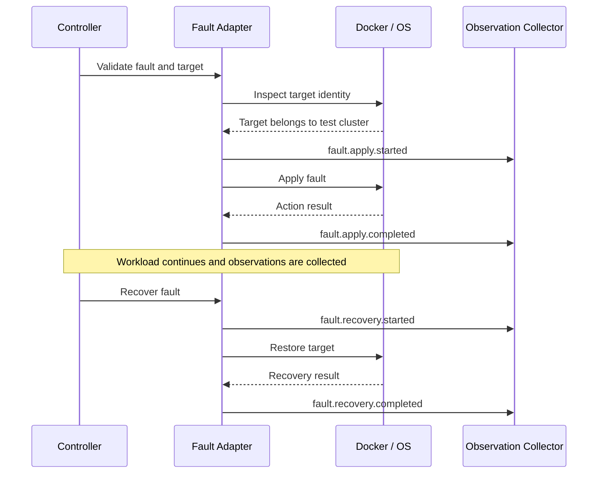

# 06 — Fault Injection

## 1. Responsibility

The fault injector applies controlled failures to simulator-owned resources and records exactly what happened. It must never silently target arbitrary Docker containers or host interfaces.

## 2. Fault lifecycle



## 3. Initial fault types

### Broker stop

Stop one explicitly configured broker container. Record requested time, actual action time, command result and observed health transition.

### Broker start

Start the same broker and wait for a scenario-defined health condition. Container running is not necessarily equivalent to broker ready.

## 4. Later fault types

| Fault | Candidate mechanism | Important caveat |
|---|---|---|
| Added latency | Linux `tc netem` | Must target the intended interface/direction |
| Packet loss | Linux `tc netem` | Record loss percentage and scope |
| Jitter | Linux `tc netem` | Actual distribution may differ from configured intent |
| Network partition | Docker network or namespace rules | Distinguish one-way and two-way isolation |
| Disk pressure | Dedicated test volume/quota | Never fill the host filesystem |
| Slow storage | Controlled test filesystem/device | Must avoid impacting unrelated workloads |
| CPU pressure | Container resource limits | Separate injected limit from host contention |

## 5. Proposed Go interface

```go
type Fault interface {
    Name() string
    Validate(ctx context.Context, target Target) error
    Apply(ctx context.Context, target Target) (FaultHandle, error)
    Recover(ctx context.Context, handle FaultHandle) error
}
```

A handle stores the exact applied target and parameters required for recovery. Recovery must not guess which resource to restore.

## 6. Safety requirements

1. Destructive faults require an explicit disposable-environment declaration.
2. Validate container labels and compose project identity before action.
3. Never run host-wide network rules in the MVP.
4. Network faults must be scoped to a dedicated test network or namespace.
5. Every applied fault is added to an active-fault registry.
6. Controller cancellation triggers recovery attempts.
7. Fault action and recovery failures are recorded.
8. A cleanup command must not remove unowned resources.

## 7. Fault scheduling

Faults use experiment-relative monotonic deadlines. If the controller is delayed, record scheduled and actual timestamps. The default policy should execute late rather than silently skip a fault, unless the scenario explicitly defines a maximum lateness tolerance.

## 8. Fault versus recovery

A successful Docker stop command proves only that the command completed. It does not prove the cluster detected the failure. A successful Docker start proves only that the container started. Recovery assertions must use broker-level readiness and behavior.
