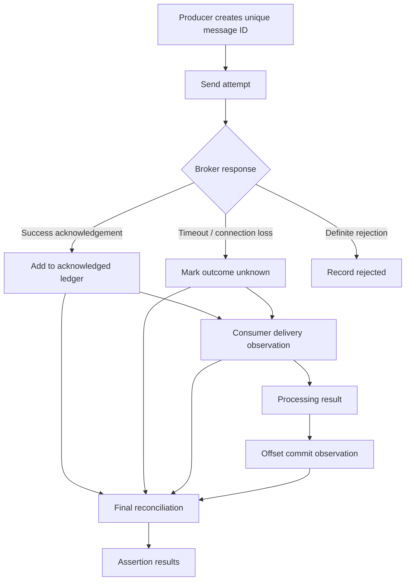

# 08 — Correctness Oracle

## 1. Purpose

The correctness oracle evaluates what the broker did against the experiment's delivery contract. It must distinguish confirmed facts from ambiguous outcomes.

## 2. Message lifecycle

## 3. Separate observations

Maintain distinct records for:

- `attempted`: producer attempted to send the message.
- `acknowledged`: producer received successful broker acknowledgement.
- `unknown_outcome`: producer did not receive a definitive result.
- `rejected`: broker definitively rejected the request.
- `delivered`: consumer observed the message.
- `processed`: consumer completed processing.
- `committed`: consumer offset progress was committed.

These sets must not be collapsed into a single sent/received counter.

## 4. Message identity

Use a stable key such as `(run_id, producer_id, sequence_number)`. A retry should preserve the same logical message identity if the client/broker idempotency contract supports that interpretation. If the broker treats retries as new appends, the oracle should expose duplicate records rather than hide them.

## 5. Core assertions

| Assertion | Meaning | Prerequisite |
|---|---|---|
| `partition_offsets_monotonic` | Observed offsets do not move backward within a partition | Offset observations |
| `queue_capacity_respected` | Queue never exceeds configured capacity | Queue-depth metric or broker assertion |
| `no_acknowledged_message_loss` | Every acknowledged message is accounted for under the declared durability boundary | Defined ack semantics and complete observation window |
| `no_duplicate_delivery` | No logical ID is delivered more than once | Defined delivery contract; may be expected to fail under at-least-once |
| `consumer_commits_monotonic` | Committed offsets do not move backward | Commit observations |
| `no_dual_leader` | No two leaders accept writes for the same partition at the same epoch | Leadership/epoch observability and implemented election model |
| `residency_policy_respected` | No placement/replication outside permitted regions | Trusted region metadata and policy audit events |

## 6. Ambiguous producer outcomes

A producer timeout does not prove that the broker failed to append. The request may have succeeded while the acknowledgement was lost.

Therefore:
- Do not count a timeout as a definite rejected message.
- Preserve the message ID in `unknown_outcome`.
- Reconcile with consumer observations and broker offsets where possible.
- Report unresolved outcomes separately.

## 7. Delivery semantics

The Hydra Stream blueprint targets at-least-once delivery initially. Duplicate delivery may therefore be expected. The oracle must not mark a run incorrect merely because a message is delivered more than once unless the scenario has a stronger, implemented idempotency contract.

## 8. Assertion statuses

Use explicit statuses:

- `PASSED`
- `FAILED`
- `SKIPPED_UNSUPPORTED`
- `INCONCLUSIVE` — required observations missing or ambiguous
- `NOT_RUN` — assertion disabled

A skipped or inconclusive assertion is not a pass.

## 9. Observation completeness

If the workload or collector drops events, the oracle must mark dependent assertions inconclusive. It should report the reason and the affected time range.

## 10. Future extension

As replication, leader epochs, recovery and regional policy become available, add assertions that consume those explicit broker observations. Do not infer internal cluster state solely from Docker container status.
