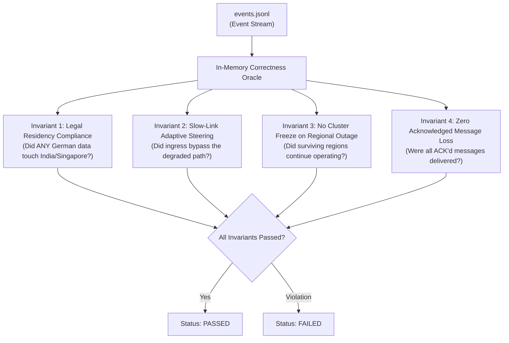

# 08 — Correctness Oracle & Verification Engine

## 1. What is the Correctness Oracle?

The **Correctness Oracle** is a self-contained, in-memory algorithmic verifier written in Go.  
It has **zero third-party or paid dependencies**. It runs entirely locally by inspecting the in-memory event stream (`events.jsonl`) generated during the simulation run.

The Oracle determines whether the system maintained its guarantees under chaos and failure.

---

## 2. The 4 Fundamental Invariants Evaluated

### Invariant 1: `legal_data_residency_respected`
* **Rule**: For any topic tagged with a legal residency (e.g. `legal_region: Germany`), verify that:
  $$\text{Brokers}(\text{Topic}) \subseteq \text{AllowedRegion}$$
* If even a single byte of message payload or offset metadata is observed on a broker in India or Singapore, the Oracle flags:  
  **`FAILED: LEGAL_RESIDENCY_VIOLATION`**.

### Invariant 2: `route_bypassed_during_degradation`
* **Rule**: During the window where the link between India and Germany was injected with 350ms latency, the Oracle verifies that client produce latency did not degrade to $\ge 350\text{ms}$ on adaptive topics, proving that the traffic was steered around the degraded link.

### Invariant 3: `no_cluster_freeze_during_regional_blackout`
* **Rule**: When region Singapore was stopped (blackout), the Oracle checks timestamps of produce/consume operations in India and Germany. If operations in surviving regions stalled for $> 2$ seconds, it flags **`FAILED: CLUSTER_FREEZE_DETECTED`**.

### Invariant 4: `no_acknowledged_message_loss`
* **Rule**: Every message that received a successful `PRODUCE_ACK` from a broker must either:
  1. Be observed by a consumer during the experiment window, OR
  2. Remain intact in the broker's in-memory partition queue.
* Monotonic offsets must never regress backwards.
