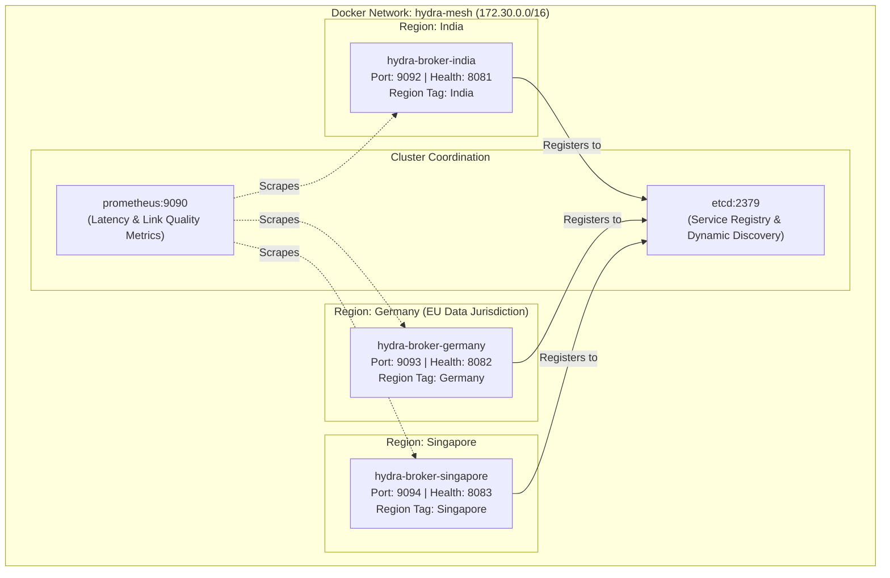

# 09 — Cluster Deployment & Docker Topology

## 1. Multi-Region Docker Architecture

To simulate geographic regions on a single development or CI machine without cloud costs, Hydra Stream deploys an isolated Docker environment with simulated regional boundaries:



---

## 2. Docker Compose Specification (`deploy/docker-compose.yml`)

```yaml
version: '3.8'

networks:
  hydra-mesh:
    driver: bridge
    ipam:
      config:
        - subnet: 172.30.0.0/16

services:
  # Dynamic Service Registry
  etcd:
    image: quay.io/coreos/etcd:v3.5.12
    container_name: hydra-etcd
    command:
      - /usr/local/bin/etcd
      - --advertise-client-urls=http://etcd:2379
      - --listen-client-urls=http://0.0.0.0:2379
    ports:
      - "2379:2379"
    networks:
      - hydra-mesh

  # Link Latency & Broker Health Observability
  prometheus:
    image: prom/prometheus:v2.51.0
    container_name: hydra-prometheus
    ports:
      - "9090:9090"
    networks:
      - hydra-mesh

  # Region 1: India Broker Node
  broker-india:
    build:
      context: ../Hydrosync
      dockerfile: Dockerfile
    container_name: hydra-broker-india
    environment:
      - BROKER_ID=broker-india-1
      - REGION=India
      - PORT=9092
      - HEALTH_PORT=8081
      - ETCD_ENDPOINTS=http://etcd:2379
    ports:
      - "9092:9092"
      - "8081:8081"
    depends_on:
      - etcd
    networks:
      - hydra-mesh

  # Region 2: Germany Broker Node (EU Legal Jurisdiction)
  broker-germany:
    build:
      context: ../Hydrosync
      dockerfile: Dockerfile
    container_name: hydra-broker-germany
    environment:
      - BROKER_ID=broker-germany-1
      - REGION=Germany
      - PORT=9093
      - HEALTH_PORT=8082
      - ETCD_ENDPOINTS=http://etcd:2379
    ports:
      - "9093:9093"
      - "8082:8082"
    depends_on:
      - etcd
    networks:
      - hydra-mesh

  # Region 3: Singapore Broker Node
  broker-singapore:
    build:
      context: ../Hydrosync
      dockerfile: Dockerfile
    container_name: hydra-broker-singapore
    environment:
      - BROKER_ID=broker-singapore-1
      - REGION=Singapore
      - PORT=9094
      - HEALTH_PORT=8083
      - ETCD_ENDPOINTS=http://etcd:2379
    ports:
      - "9094:9094"
      - "8083:8083"
    depends_on:
      - etcd
    networks:
      - hydra-mesh
```

---

## 3. Dynamic Registration Verification

When the containers start:
1. Each broker connects to `http://etcd:2379`.
2. Registers key `/registry/brokers/<broker-id>` with a 5-second TTL.
3. The Hydra Control Plane watches `/registry/brokers/` and dynamically discovers all nodes and their regions **with zero hardcoded IP addresses**.
