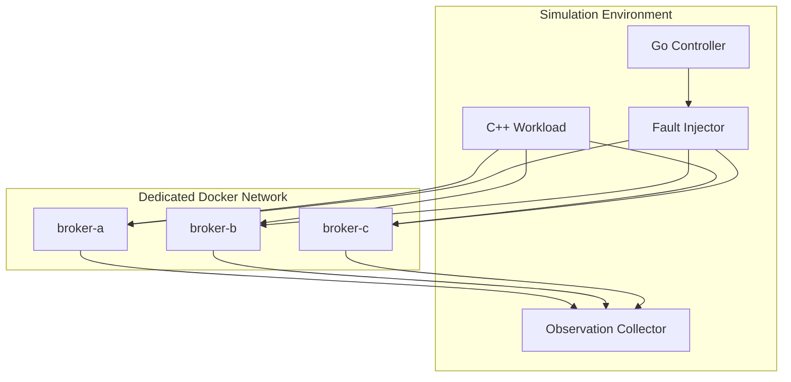

# 09 — Cluster Deployment

## 1. Initial topology

The first deployment target is three independent Hydra Stream broker containers on a dedicated Docker Compose network.



## 2. Container requirements

Each broker should have:

- Unique broker identity.
- Separate persistent data volume.
- Explicit configuration.
- Health check based on broker readiness, not only process existence.
- Resource limits suitable for repeatable local experiments.
- Structured logs.
- Metrics endpoint if implemented.
- Stable service name and network alias.

## 3. Isolation

Use a dedicated Compose project name and network for simulator runs. Label resources with the run ID where possible. The controller must discover and operate only on resources associated with the expected project and labels.

## 4. Persistence

Use separate volumes for each broker so a restart does not accidentally erase broker data. Define two different operations:

- **Restart:** preserve broker volume.
- **Reset:** remove/reinitialize only the selected disposable test data, with explicit confirmation.

The MVP crash-recovery experiment uses restart, not reset.

## 5. Compose design sketch

The exact image, executable, ports, configuration flags and health-check command must be adapted after inspecting Hydra Stream's current broker implementation.

```yaml
services:
  broker-a:
    image: hydra-broker:dev
    container_name: hydra-sim-broker-a
    volumes:
      - broker_a_data:/var/lib/hydra
    networks: [hydra-sim]

  broker-b:
    image: hydra-broker:dev
    container_name: hydra-sim-broker-b
    volumes:
      - broker_b_data:/var/lib/hydra
    networks: [hydra-sim]

  broker-c:
    image: hydra-broker:dev
    container_name: hydra-sim-broker-c
    volumes:
      - broker_c_data:/var/lib/hydra
    networks: [hydra-sim]

networks:
  hydra-sim:
    internal: false

volumes:
  broker_a_data:
  broker_b_data:
  broker_c_data:
```

This is a topology sketch, not a directly runnable Compose file. It intentionally omits unknown Hydra image commands, ports and health checks.

## 6. Readiness checks

Distinguish:
- Container created.
- Container running.
- Broker process alive.
- Broker protocol responds.
- Broker is registered/ready for the scenario.

Only the strongest available broker-level check should satisfy scenario readiness.

## 7. Local developer workflow

Proposed commands:

```bash
# Build broker image
docker build -t hydra-broker:dev -f deploy/docker/Dockerfile .

# Start the simulator cluster
docker compose -p hydra-sim -f deploy/compose/docker-compose.yml up -d

# Inspect service state
docker compose -p hydra-sim -f deploy/compose/docker-compose.yml ps

# Stop the test cluster
docker compose -p hydra-sim -f deploy/compose/docker-compose.yml down
```

The final commands must use the actual repository paths and Dockerfile after implementation.

## 8. Safety

Never point destructive simulator commands at a developer's unrelated Docker Compose project. Require an explicit project identity and verify labels before stopping, restarting, resetting or deleting resources.
