# 10 — Implementation Roadmap

## Phased Delivery Plan

```mermaid
flowchart LR
    subgraph M1["Milestone 1: Dynamic Discovery & Daemonization"]
        direction TB
        M1_A["Refactor C++ Broker into Standalone Daemon"]
        M1_B["Add Socket / Network Listener (:9092)"]
        M1_C["Add Dynamic etcd Registration with Leases"]
    end

    subgraph M2["Milestone 2: Hydra Control Plane (Go)"]
        direction TB
        M2_A["Build Go Control Plane Core"]
        M2_B["Dynamic etcd Broker Watcher"]
        M2_C["Legal Region Policy Enforcer (Germany/India/SG)"]
    end

    subgraph M3["Milestone 3: Dynamic Slow-Link Routing"]
        direction TB
        M3_A["Prometheus Link Latency Scraping"]
        M3_B["Dynamic Latency Score Calculation"]
        M3_C["Adaptive Traffic Steering (Bypassing Slow Links)"]
    end

    subgraph M4["Milestone 4: Chaos Engine & Verification"]
        direction TB
        M4_A["Linux tc netem Fault Injection"]
        M4_B["Regional Blackout Simulation"]
        M4_C["Correctness Oracle Assertion Auditing"]
    end

    M1 --> M2
    M2 --> M3
    M3 --> M4
```

---

## Milestone Descriptions

### Milestone 1: Dynamic Discovery & Daemonization (Current Target)
* Transform `Hydrosync` into a standalone network daemon.
* Add socket listener for basic `PRODUCE` and `FETCH` frames.
* Implement broker startup registration to `etcd` (`/registry/brokers/<id>`).
* Verify 3 broker containers (`India`, `Germany`, `Singapore`) start and register dynamically in Docker.

### Milestone 2: Hydra Control Plane (Go)
* Implement Go Control Plane service.
* Discover regional brokers dynamically via `etcd`.
* Implement topic metadata service enforcing legal data-residency rules (e.g. EU data locked to Germany).
* Reject unauthorized cross-border requests.

### Milestone 3: Dynamic Slow-Link Routing
* Connect Prometheus latency scraping to the Control Plane.
* Calculate dynamic link health scores.
* Steer producer traffic away from degraded links to fast regional paths.

### Milestone 4: Chaos Engine & Invariant Verification
* Implement experiment scheduler (YAML scenarios).
* Inject `tc netem` latency spikes and regional container stops.
* Run the Correctness Oracle to mathematically verify:
  1. Zero message loss.
  2. Zero residency violations.
  3. No cluster freeze on regional blackout.
