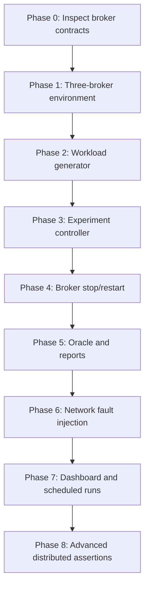

# 10 — Implementation Roadmap

## Overview

Build the simulator incrementally. Do not wait for a complete distributed broker to begin implementing the experiment infrastructure, but do not claim unsupported distributed guarantees.

## Phase 0 — Inspect existing implementation

Deliverables:
- Broker startup command and configuration.
- Current network protocol/client API.
- Produce/fetch/commit semantics.
- Health and metrics capabilities.
- Broker identity and storage path.
- Current cluster/replication capabilities.

Exit criteria: simulator interfaces are based on actual code, not guessed endpoints.

## Phase 1 — Three-broker environment

Deliverables:
- Three independent broker containers.
- Separate persistent volumes.
- Dedicated Compose project/network.
- Broker readiness checks.
- Safe start/stop operations.

Exit criteria: three broker processes start and can be independently inspected and restarted.

## Phase 2 — C++ workload generator

Deliverables:
- Client adapter.
- Producer and consumer workers.
- Unique message IDs.
- Constant-rate workload.
- Bounded in-flight requests.
- Client event output.

Exit criteria: multiple producers and consumers exchange messages through the real broker interface.

## Phase 3 — Go experiment controller

Deliverables:
- YAML schema and validator.
- Run ID and artifact directory.
- Lifecycle state machine.
- Child-process supervision.
- Experiment-relative scheduler.

Exit criteria: a baseline experiment can run end-to-end without faults.

## Phase 4 — Broker fault injection

Deliverables:
- Broker stop/start adapters.
- Active fault registry.
- Recovery handling.
- Fault event timeline.

Exit criteria: stop and restart a broker during active workload and save observations.

## Phase 5 — Oracle and reporting

Deliverables:
- Message and offset ledger.
- Assertion status model.
- Latency histogram.
- Throughput/error metrics.
- JSON and Markdown report.

Exit criteria: report separates execution outcome, correctness outcome and performance outcome.

## Phase 6 — Network faults

Deliverables:
- Dedicated namespace/network rules.
- Latency, jitter and packet loss.
- Link-scoped partition.
- Guaranteed cleanup/recovery.

Exit criteria: faults affect only intended test links and are fully reversible.

## Phase 7 — Dashboard and recurring experiments

Deliverables:
- Run history.
- Fault timeline.
- Latency/throughput charts.
- Comparison view.
- Optional scheduler integration.

Exit criteria: dashboard reads saved experiment data and does not participate in broker-critical operations.

## Phase 8 — Advanced distributed assertions

Add replication lag, leader epoch, split-brain, failover, regional placement and residency assertions only after corresponding broker capabilities and observations exist.
