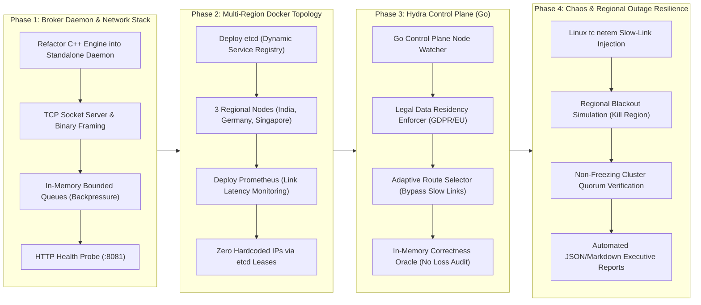
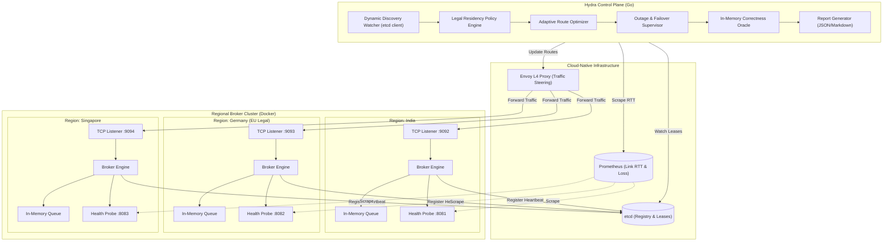
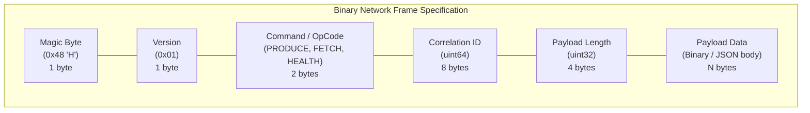
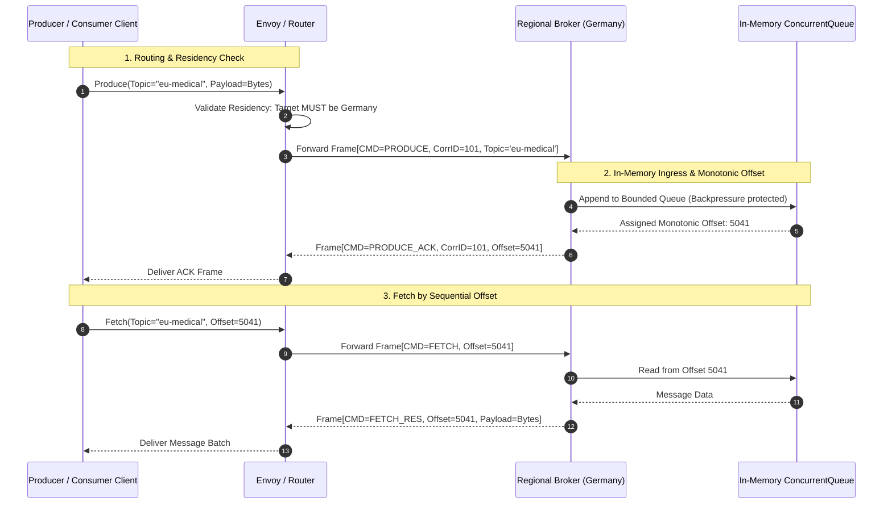
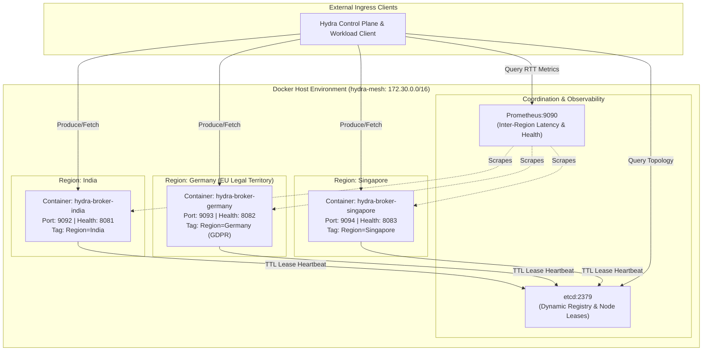
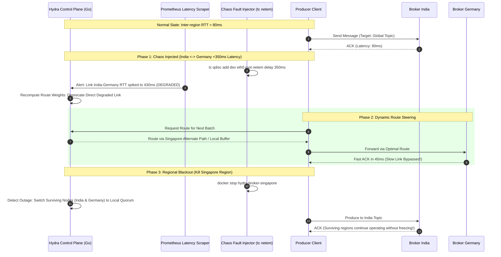
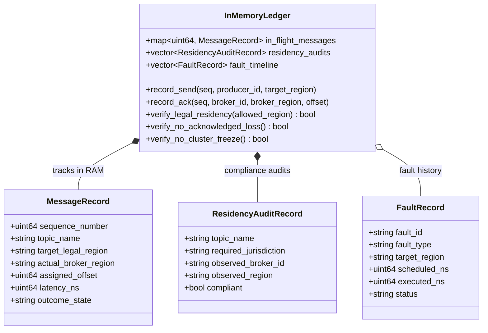
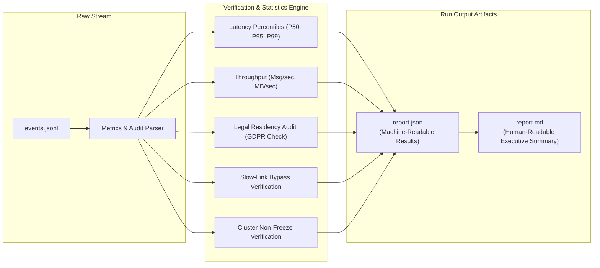

# Hydra Stream — Comprehensive Visual Architecture & Phase Diagrams

This document consolidates all architectural, networking, lifecycle, fault injection, and correctness diagrams for the Hydra Stream geo-distributed platform using Mermaid.

---

## 1. End-to-End Implementation Roadmap (Phases 1–4)

---

## 2. High-Level System Architecture & Component Boundaries

---

## 3. Network Architecture & Wire Protocol

### 3.1 Binary Frame Format (TCP Framing)

### 3.2 Client–Broker Request / Response Sequence

---

## 4. Three-Region Cluster Deployment with etcd (Docker Compose)

---

## 5. Dynamic Slow-Link Routing & Regional Outage Sequence

---

## 6. Correctness Oracle In-Memory Data Model (RAM Structs — Zero Database)

> [!NOTE]
> No database (SQL, NoSQL, or embedded) is used. The verification engine maintains high-speed in-memory data structures (hash maps, vectors, and concurrent queues in RAM) to track and reconcile message lifecycles and compliance in real time.

---

## 7. Metrics Aggregation & Reporting Pipeline

