# Hydra Stream — Comprehensive Visual Architecture & Phase Diagrams

This document consolidates all architectural, networking, lifecycle, fault injection, and correctness diagrams for the Hydra Stream and Hybrid Simulation Engine platform using Mermaid.

---

## 1. End-to-End Implementation Roadmap (Phases 1–4)

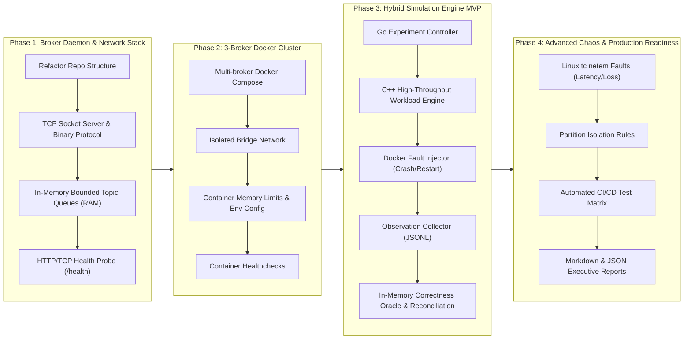

---

## 2. High-Level System Architecture & Component Boundaries

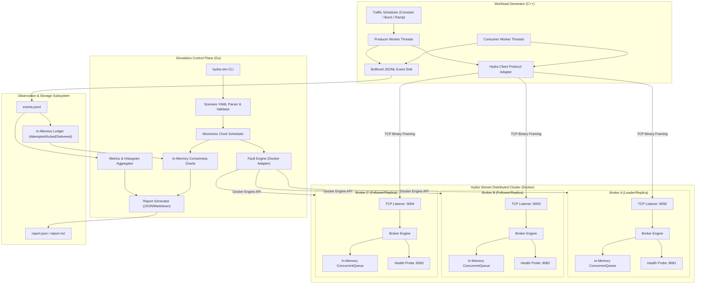

---

## 3. Network Architecture & Wire Protocol

### 3.1 Binary Frame Format (TCP Framing)

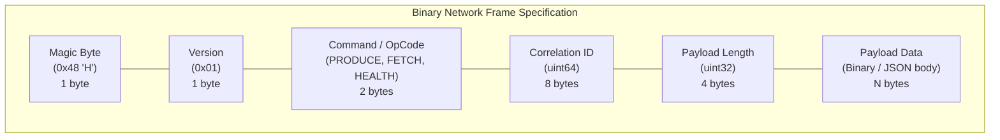

### 3.2 Client–Broker Request / Response Sequence

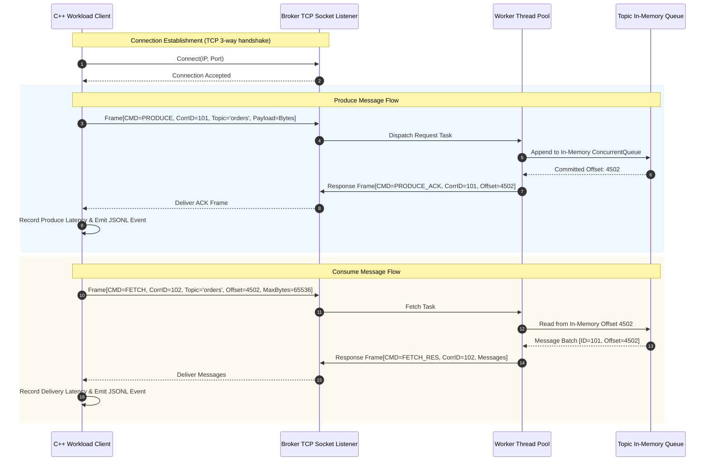

---

## 4. Broker Internal Multi-Threading & In-Memory Storage

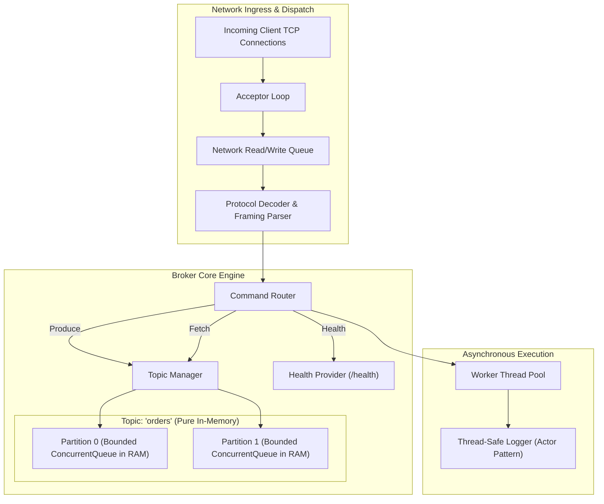

---

## 5. Three-Broker Cluster Deployment (Docker Compose)

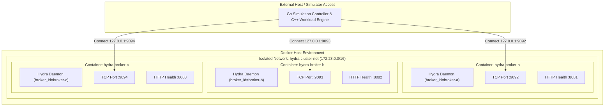

---

## 6. Workload Engine Concurrency & Flow

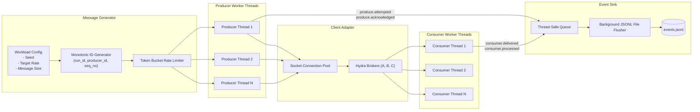

---

## 7. Experiment Lifecycle State Machine

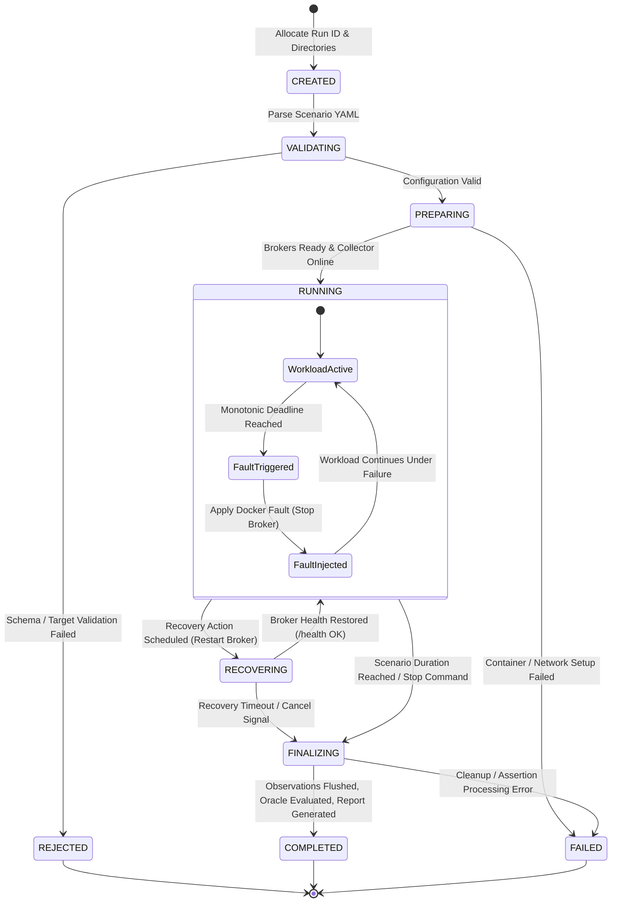

---

## 8. Fault Injection & Chaos Recovery Sequence

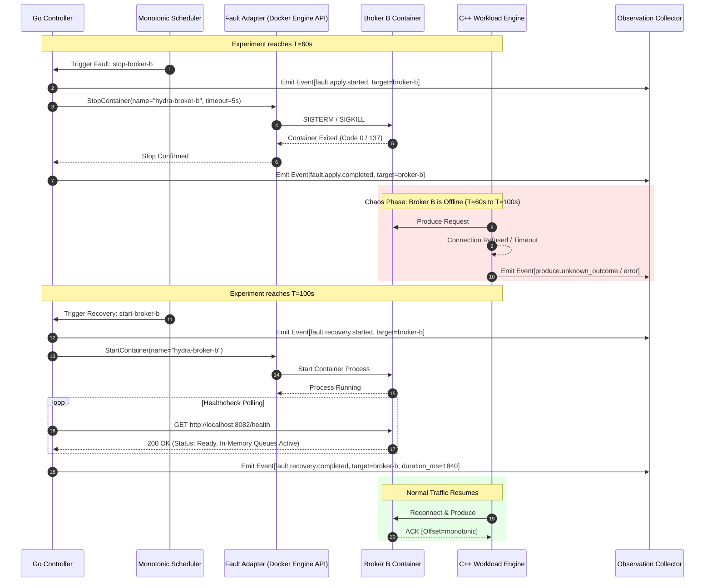

---

## 9. Correctness Oracle In-Memory Data Model (Pure RAM Structs — No Database)

> [!NOTE]
> No database (SQL, NoSQL, or embedded) is used. The verification engine maintains high-speed in-memory data structures (hash maps, vectors, and concurrent queues in RAM) to track and reconcile message lifecycles in real time.

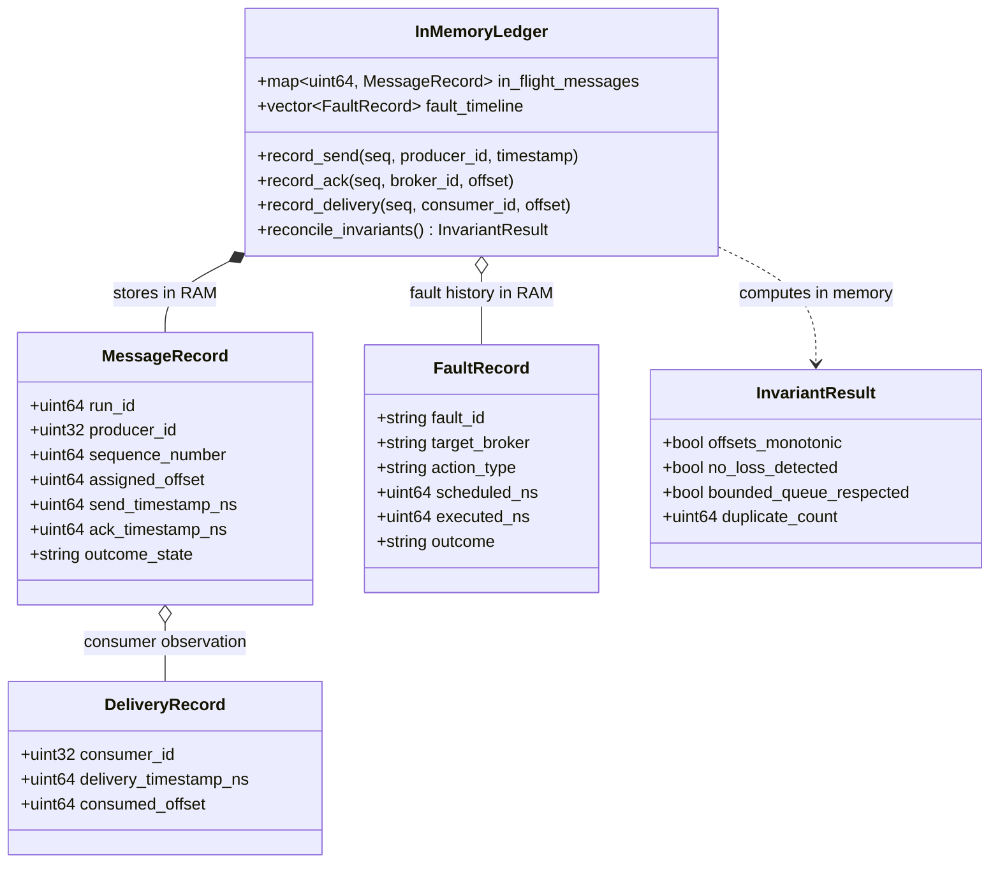

---

## 10. Correctness Ledger Reconciliation Flow

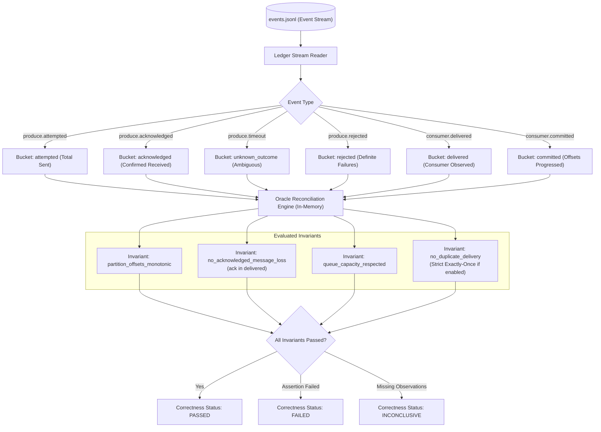

---

## 11. Metrics Aggregation & Reporting Pipeline

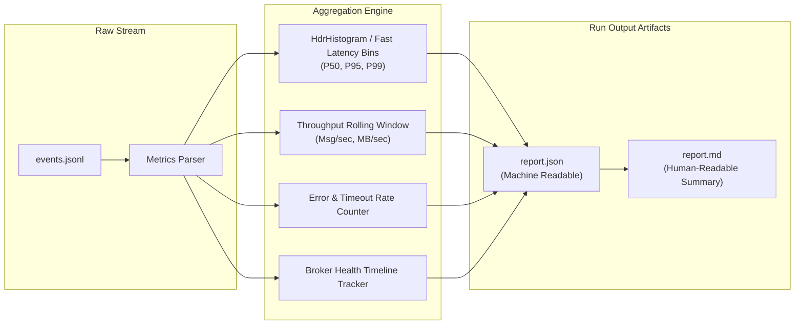
