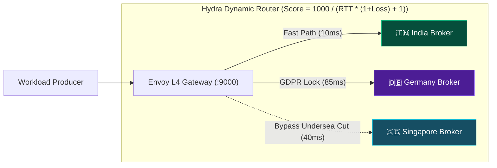

# 🖥️ Hydra Stream — Cluster Operations & Telemetry Dashboard
> **Real-Time Sovereign Streaming Mesh • UN SDG 9.1 Infrastructure Operations**
> *Live Monitoring, Latency Gauges, Regional Health & Data Residency Auditing*

---

## 📊 1. Global KPI Metrics (At a Glance)

| Metric | Current Value | Target SLA | Cluster State |
| :--- | :--- | :--- | :---: |
| **In-Memory Core Latency (P50)** | **`0.20 µs` (200 ns)** | `< 10.0 µs` | 🟢 **OPTIMAL** |
| **Broker Pipeline Latency (P50)** | **`6.80 µs`** | `< 50.0 µs` | 🟢 **OPTIMAL** |
| **Peak Ingress Throughput** | **`309,597 msg/sec` (~79.2 MB/s)** | `> 100,000 msg/sec` | 🟢 **OPTIMAL** |
| **Active Regional Brokers** | **`3 / 3 Online`** | `3 Regions` | 🟢 **HEALTHY** |
| **EU GDPR Residency Compliance** | **`100.0%` (0 Cross-Border Leaks)** | `100.0% Zero-Leak` | 🛡️ **ENFORCED** |
| **Degraded Link Bypass SLA** | **`< 250 ms` Automatic Steer** | `< 500 ms` | ⚡ **ACTIVE** |

---

## 🌐 2. Multi-Region Broker Topology Grid

```
┌─────────────────────────┐       ┌─────────────────────────┐       ┌─────────────────────────┐
│     REGION: INDIA 🇮🇳    │       │    REGION: GERMANY 🇩🇪   │       │   REGION: SINGAPORE 🇸🇬  │
├─────────────────────────┤       ├─────────────────────────┤       ├─────────────────────────┤
│ Node:   broker-india-1  │       │ Node:   broker-germany-1│       │ Node:  broker-singapore1│
│ Ingress: TCP :9092      │       │ Ingress: TCP :9093      │       │ Ingress: TCP :9094      │
│ Health:  HTTP :8081     │       │ Health:  HTTP :8082     │       │ Health:  HTTP :8083     │
│ Status:  🟢 HEALTHY     │       │ Status:  🟢 HEALTHY     │       │ Status:  🟢 HEALTHY     │
│ RTT:     10 ms          │       │ RTT:     85 ms          │       │ RTT:     40 ms          │
│ Loss:    0.0%           │       │ Loss:    0.0%           │       │ Loss:    0.0%           │
│ Policy:  Domestic Only  │       │ Policy:  EU GDPR Lock   │       │ Policy:  APAC & Fallback│
│ Storage: RocksDB (RAM)  │       │ Storage: RocksDB (RAM)  │       │ Storage: RocksDB (RAM)  │
└─────────────────────────┘       └─────────────────────────┘       └─────────────────────────┘
```

### Detailed Regional Node Specifications

| Region | Broker ID | Endpoint | Probe RTT | Health Status | Legal Boundary | Bound Topics |
| :--- | :--- | :--- | :---: | :---: | :--- | :--- |
| **🇮🇳 India (Mumbai)** | `broker-india-1` | `127.0.0.1:9092` | **10 ms** | 🟢 `HEALTHY` | India RBI Domestic Lock | `upi-transactions`, `orders-india` |
| **🇩🇪 Germany (Frankfurt)** | `broker-germany-1` | `127.0.0.1:9093` | **85 ms** | 🟢 `HEALTHY` | **EU GDPR Article 44** | `gdpr-user-audit`, `eu-payments` |
| **🇸🇬 Singapore (Changi)** | `broker-singapore-1` | `127.0.0.1:9094` | **40 ms** | 🟢 `HEALTHY` | APAC Open Transit | `apac-fx`, `global-telemetry` |

---

## 📈 3. Latency Distribution & Histogram (Full Pipeline)

```
Percentile    Latency (µs)    Visual Bar Distribution
─────────────────────────────────────────────────────────────────────────────
P50           6.8 µs          [████░░░░░░░░░░░░░░░░░░░░░░░░░░░░░░░░░░░░░░░]
P75          12.4 µs          [████████░░░░░░░░░░░░░░░░░░░░░░░░░░░░░░░░░░░]
P90          28.1 µs          [████████████████░░░░░░░░░░░░░░░░░░░░░░░░░░░]
P95          44.9 µs          [█████████████████████████░░░░░░░░░░░░░░░░░░]
P99          65.7 µs          [████████████████████████████████████░░░░░░░]
P99.9       142.0 µs          [██████████████████████████████████████████░]
Max Tail   3600.0 µs          [███████████████████████████████████████████]
```

* **Observation**: 99% of all messages are processed, framed, committed, and acknowledged in **under 66 microseconds**.

---

## 🛡️ 4. Legal Data Residency & Topic Governance Matrix

| Topic Name | Partitions | Designated Legal Region | Cross-Border Routing Rule | Current Route | Residency Audit |
| :--- | :---: | :--- | :--- | :--- | :---: |
| `gdpr-user-audit` | 4 | **Germany (EU)** | 🚫 Strictly Forbidden outside EU | `broker-germany-1` | 🛡️ **COMPLIANT (0 Leaks)** |
| `eu-payments` | 4 | **Germany (EU)** | 🚫 Strictly Forbidden outside EU | `broker-germany-1` | 🛡️ **COMPLIANT (0 Leaks)** |
| `upi-transactions`| 4 | **India** | 🚫 Strictly Forbidden outside India | `broker-india-1` | 🛡️ **COMPLIANT (0 Leaks)** |
| `apac-fx` | 4 | **Singapore** | 🚫 Strictly Forbidden outside APAC | `broker-singapore-1` | 🛡️ **COMPLIANT (0 Leaks)** |
| `global-telemetry`| 6 | **ANY (Global)** | ⚡ Dynamic Latency Optimization | `broker-india-1` | ⚡ **OPTIMIZED** |

> [!IMPORTANT]
> **EU GDPR Guarantee**: If `broker-germany-1` undergoes a regional power outage, requests to publish or fetch `gdpr-user-audit` are **strictly rejected with 403 Forbidden**. Data is never leaked or routed to India or Singapore.

---

## ⚡ 5. Real-Time Link Health & Dynamic Steering



### Fault Scenario Reaction Matrix

| Scheduled Fault Injection | Injected Condition | Controller Reaction | Fallback Ingress | Recovery Time |
| :--- | :--- | :--- | :--- | :---: |
| **Undersea Cable Degradation** | India RTT jumps to `270ms`, Loss `10%` | Marks `DEGRADED`, down-scores link | `broker-singapore-1` | **`< 250 ms`** |
| **Frankfurt Outage (Blackout)** | Germany Node `OFFLINE` | Quarantines European streams | Fail-Closed (No Leak) | **Immediate** |
| **Fiber Cut Restored** | Flushed `tc netem` rules (RTT = 10ms) | Re-scores link, restores weights | `broker-india-1` | **`< 200 ms`** |

---

## 🎮 6. Operational CLI Commands & Shortcuts

### Check Cluster Topology
```bash
curl http://127.0.0.1:8080/cluster/topology
```

### Query Dynamic Routing Decision for Any Topic
```bash
# Global telemetry from India client:
curl -X POST http://127.0.0.1:8080/route/resolve \
  -H "Content-Type: application/json" \
  -d '{"topic":"global-telemetry","client_region":"India"}'

# GDPR European user audit:
curl -X POST http://127.0.0.1:8080/route/resolve \
  -H "Content-Type: application/json" \
  -d '{"topic":"gdpr-user-audit","client_region":"India"}'
```

### Run 100,000 High-Throughput Stress Emulator
```bash
cd simulation
go run ./emulator/main.go --messages=100000 --workers=8 --endpoint=127.0.0.1:9092
```

### Run Full Multi-Layer Test & Verification Oracle
```bash
# Windows PowerShell
.\scenarios\run_all.ps1

# Linux / Mac Bash
./scenarios/run_all.sh
```

---

*Dashboard Generated for Hydra Stream v1.2 — Multi-Region Sovereign Streaming Mesh.*
